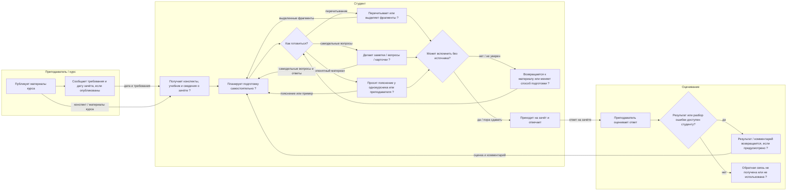

# As-is: подготовка студента к зачёту

**Статус:** рабочая модель процесса, а не результат наблюдения за студентом. Участники, развилки и передаваемые материалы реконструированы по контексту проекта и должны быть проверены интервью/walkthrough.

## Официальное описание процесса

В доступных материалах репозитория не найден официальный регламент подготовки студента к зачёту: нет syllabus с порядком подготовки, инструкции преподавателя, приказа или зафиксированной устной договорённости. Документы лабораторных описывают требования к проекту, но не регламентируют действия студента.

Ссылка Disputa на работу 3 при проверке 2026-10-27 перенаправила на `/login`; содержание курса и возможные инструкции за входом недоступны. Поэтому корректный вывод: **официальное описание не найдено в доступных источниках; это не доказывает, что его не существует вне репозитория и публичных страниц**. Необходимый следующий источник — syllabus/страница курса или подтверждение преподавателя.

## Модель процесса

Пункты со знаком `?` — непроверенные предположения о реальной практике. Модель показывает участника, шаги, развилки и что передаётся между шагами.

## Передаваемые объекты

| Переход | Что передаётся | Что пока неизвестно |
| --- | --- | --- |
| Курс → студент | Конспекты/учебные материалы, сведения о требованиях и дате | Канал, полнота, срок публикации и официальный обязательный порядок |
| Студент → собственная подготовка | Выбранные темы, заметки, собственные вопросы или карточки | Как часто используются карточки и сколько времени уходит на выбор тем |
| Однокурсник/преподаватель → студент | Устное пояснение или пример, если студент обращается | Частота обращений и качество ответа |
| Студент → оценивание | Устный или письменный ответ на зачёте | Критерии оценивания и доступность разбора ошибок |
| Оценивание → студент | Оценка/комментарий, если курс это возвращает | Возвращается ли обратная связь и влияет ли она на последующую подготовку |

## Источники и предел уверенности

- Подтверждено материалами проекта: студент готовится по собственным конспектам/учебникам; целевой результат — воспроизвести материал к зачёту. Это описание задачи проекта, не наблюдение процесса.
- Подтверждено публичным walkthrough Disputa: маршрут `/app/works/3` без авторизации перенаправляет на вход. Это не доказывает, что студенты используют именно этот канал для материалов курса.
- Не подтверждено: конкретная последовательность шагов студента, каналы доступа к материалам, развилки, причины выбора способа подготовки и выдача обратной связи.

Для превращения схемы в фактическую as-is-модель провести минимум 3 walkthrough по последней реальной подготовке: попросить студента показать материалы и восстановить, что он делал, в каком порядке, что выбирал на развилках и какие данные/артефакты передавал дальше.