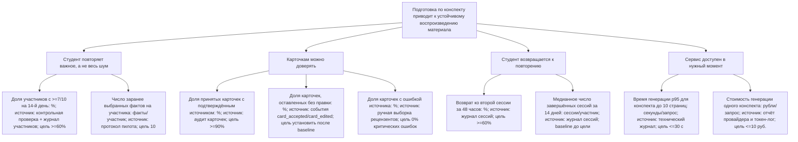

# Дерево целей и показатели

Корень дерева — цель системы. Каждый лист содержит единицу измерения и источник числа. Числа 60%, 7/10, 14 дней, 30 секунд и 10 рублей — целевые пороги из PRD, а не уже измеренный результат.

## Правила чтения дерева

- Лист нельзя считать измеренным, пока не собран названный источник числа.
- «Baseline до цели» означает, что сначала нужен замер, а не что показатель уже достигнут.
- Главный лист цели — доля участников с результатом не ниже 7/10; остальные листья объясняют, почему она может быть достигнута или сорвана.
- Пропуск 14-дневной проверки входит в знаменатель и считается неуспехом, чтобы результат нельзя было улучшить исключением пропавших участников.

## Какая ветка сейчас проседает

Сейчас проседает ветка **«Карточкам можно доверять»**, точнее её доказательная база. Это не утверждение, что качество продукта уже измеренно плохое: продукт ещё не проходил пилот. Утверждение означает, что именно для этой ветки в репозитории нет наблюдаемого baseline и нет проведённой проверки источника.

Источник знания — [аудит доказательной базы](evidence-audit.md) от 2026-10-26:

- подтверждённых пользовательских интервью: **0**;
- карточек, прошедших ручной аудит по источнику: **0**;
- пилотных запросов генерации с замером ошибок: **0**;
- наблюдений Disputa: **3**, но все относятся к экрану входа и не измеряют качество карточек.

Поэтому первым действием после проектирования должен стать набор карточек из реального конспекта и ручной аудит не менее 20 карточек по рубрике источника. До этого нельзя объявлять ветку качества «зелёной».