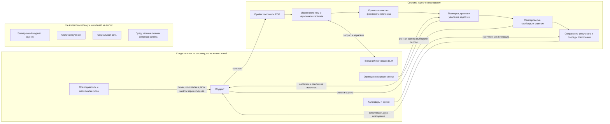

# Краткая записка о системе

**Рабочая модель для пилота:** один курс и одна группа студентов первого курса прикладной экономики. Проведены пять наблюдений за созданием карточек; все участники подтверждены как целевые студенты, использующие собственные конспекты к зачёту. Наблюдения дают конкретные примеры процесса, но не устанавливают частоту болей в сегменте. Для интервью определены пять целевых участников, но ответы и результаты подсчёта ещё не внесены. Оценка AI-карточек и двухнедельный пилот повторений также остаются планами; статус и методика сведены в [записке об исследовании](../lab-3/insights.md).

Краткая формулировка цели и протокол подсчёта вынесены в [отдельную записку](system-goal.md).

## Учебная система до продукта

До появления карточного сервиса подготовка уже происходит в связке «преподаватель — курс — студент»: преподаватель задаёт программу и контроль, конспекты и учебники дают материал, а студент сам выбирает, что учить и как повторять — перечитывает, делает заметки или вопросы, сверяется с материалами и однокурсниками. Эта система нужна, чтобы студент освоил содержание курса и показал знания на зачёте. Новый сервис — только возможное вмешательство в шаги выбора фактов, самопроверки и повторения, а не вся система обучения. Это рабочая модель процесса; конкретные привычки целевой группы нужно проверять отдельно.

## Цель и наблюдаемый признак

Через 14 дней после начала пилота не менее 60% всех начавших должны без конспекта воспроизвести минимум 7 из 10 заранее выбранных ключевых фактов из своего материала. Каждый факт оценивается по заранее зафиксированной рубрике: смысл сохранён — 1, иначе — 0; пропуск контрольной проверки считается недостижением. Проверяем по закрытой контрольной работе и журналу участников. Это целевой порог, а не уже полученный результат. Чтобы понять, является ли он амбициозным, нужно сравнить результат на 14-й день с сопоставимой группой, которая готовилась тот же период без сервиса, используя тот же протокол и рубрику. Если группа без сервиса уже достигает 60% на уровне 7/10, порог сам по себе не будет амбициозной целью; до пилота следует пересмотреть целевое значение или задать требуемый прирост. Опрос о том, какой результат студенты считают полезным, можно использовать как дополнительный контекст, но не как замену измерению знаний. При малой выборке сравнение будет предварительным, без обобщения на всех студентов; если сопоставимую группу набрать нельзя, 60% остаётся непроверенной рабочей целью, а не доказанно высокой планкой.

## Граница системы

## Стороны и несовпадающие цели

| Сторона | Своя цель | Где расходится с другими |
| --- | --- | --- |
| Студент | Быстрее подготовиться и вспомнить главное; сохранить приватность конспекта | Хочет короткий набор и быстрый ответ, тогда как преподавателю важно покрытие курса, а команде нужны данные для проверки качества |
| Преподаватель / курс | Сохранить точность и соответствие материалам курса, не подменять обучение угадыванием зачёта | Полное покрытие курса может дать больше карточек, чем студент готов повторять |
| Команда продукта и качества | Проверить пользу, полноту карточек и удержание по метрикам | Сбор подробной телеметрии облегчает оценку, но конфликтует с приватностью студента |
| Поставщик модели | Получать запросы в рамках своего API и условий обработки данных | Команде нужны ограничение стоимости и контроль над тем, как обрабатываются конспекты |
| Однокурсник-рецензент | Быстро и понятно оценить карточки | Команде нужны подробные независимые оценки, но большая разметка увеличивает нагрузку рецензента |

## Спорные элементы границы

- **Почему граница проведена здесь:** в первом пилоте оцениваем конкретный цифровой сценарий, которым управляет команда: загрузка конспекта, создание и проверка карточек, свободный ответ и возврат к повторению. Студент и курс остаются средой, потому что сервис не управляет обучением, программой или зачётом; преподаватель не интегрируется с продуктом и не передаёт ему данные. Расширение границы на курс или преподавателя потребовало бы отдельного сценария, согласований и интеграций, которые не нужны для проверки этого узкого сценария.
- **Преподаватель:** внешняя среда, не пользователь MVP. Он задаёт содержание курса и контекст зачёта, но система не получает от него данные напрямую.
- **Поставщик модели:** внешняя зависимость; система отправляет ему запрос на генерацию, но выбор модели и её внутреннее устройство не входят в продуктовую границу.
- **Однокурсники-рецензенты:** участники ручной проверки пилотной выборки, а не часть обычного сценария студента.
- **Хранение конспектов и ответов:** обработка и прогресс относятся к системе, но срок хранения и доступ команды пока не согласованы. До решения хранить минимум данных и не использовать личные сведения.
- **Электронный журнал, платежи и предсказание вопросов зачёта:** сознательно вне границы и без интеграций в первом пилоте.

## Телеметрия и приватность пилота

Для проверки возврата к повторению и результата на 14-й день в телеметрии храним только случайный код участника, время начала и завершения сессий, факт завершения второй сессии, итоговый балл из 10 и десять бинарных оценок по заранее заданным фактам. Контактные данные для организации проверки, если они понадобятся, хранятся отдельно от кодированной таблицы и удаляются после завершения проверки.

В аналитическую телеметрию не включаем имя, аккаунт, исходный конспект, текст карточек, фрагменты источника, свободные ответы, промпты, историю действий по отдельным карточкам или клавиатурный ввод. Проверяющий выставляет баллы по рубрике; тексты ответов не сохраняются в аналитическом наборе. Для отдельной проверки качества карточек можно использовать ограниченную выборку карточек и исходных фрагментов только с согласием участника, без идентификаторов и отдельно от телеметрии; материалы удаляются после оценки. Оставляя только агрегированные метрики и минимум кодированных событий, команда отказывается от подробной диагностики ошибки по конкретному студенту и карточке. Срок хранения кодированных записей и доступ к ним нужно утвердить до пилота и сообщить участникам.

## Наблюдения из похода в систему

**Дата:** 2026-10-19. **Объект walkthrough:** публичная часть Disputa, открытая без авторизации по ссылке на [работу 1](https://disputa.ru/app/works/1). Эти наблюдения относятся только к маршруту входа и доступным без входа элементам интерфейса; в рамках этого walkthrough за студентами и их работой с карточками мы не наблюдали, гипотезы продукта этими наблюдениями не подтверждаются.

| Наблюдение | Что увидели | Чем удивило |
| --- | --- | --- |
| 1. Прямая ссылка на работу | Открыли `/app/works/1` без авторизации; адрес перенаправил на `/login` (HTTP 200). | URL конкретной работы выглядит прямым, но её содержимое не доступно до входа. |
| 2. Публичные и закрытые сценарии | На странице входа отдельно перечислены действия «Без входа» (опрос времени, итоговая карточка работы) и «Со входом» (переход из LMS, приглашение в курс, онлайн-приёмка). | Без входа доступны отдельные вспомогательные сценарии, но не сама работа курса. |
| 3. Способы входа и контекст курса | Страница предлагает Яндекс ID, VK ID, GitVerse и LMS; в тексте сказано, что код организатора определяет курс и роль, а пароль не обязателен. | Доступ связан не только с аккаунтом: приглашение задаёт учебный контекст и роль. |

Эти три пункта — наблюдения интерфейса Disputa, а не поведения студентов. Отдельно проведены четыре интервью (см. [записку об интервью и наблюдении](../lab-3/insights.md)); их ответы о прошлом опыте являются ретроспективными самоотчётами. Также записаны пять сессий создания карточек при исследователе. Все пять участников относятся к целевому сегменту и готовятся по собственным конспектам к зачёту по целевому курсу. В наблюдениях представлены пары «исходный фрагмент — карточка», показывающие сохранение основного смысла, преобразование списка в структурированный ответ и сокращение длинного материала. Отмечены также разные основания выбора: объяснения преподавателя, предпочтение списка, жирное выделение и неуверенность при выборе формулы. Это конкретные примеры поведения пяти участников, а не подтверждение распространённости критериев среди всех студентов. Подробные результаты и ограничения приведены в [записке об интервью и наблюдении](../lab-3/insights.md).