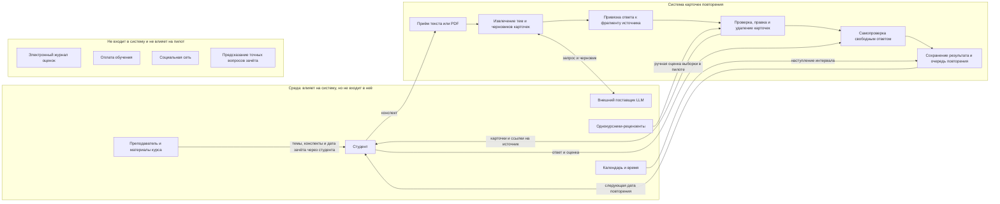

# Краткая записка о системе

**Рабочая модель для пилота:** один курс и одна группа студентов первого курса прикладной экономики. Боли и пороги пока являются гипотезами; цель пилота задана измеримо, но целевое значение ещё требует согласования с Quality & Safety.

Краткая формулировка цели и протокол подсчёта вынесены в [отдельную записку](system-goal.md).

## Учебная система до продукта

До появления карточного сервиса подготовка уже происходит в связке «преподаватель — курс — студент»: преподаватель задаёт программу и контроль, конспекты и учебники дают материал, а студент сам выбирает, что учить и как повторять — перечитывает, делает заметки или вопросы, сверяется с материалами и однокурсниками. Эта система нужна, чтобы студент освоил содержание курса и показал знания на зачёте. Новый сервис — только возможное вмешательство в шаги выбора фактов, самопроверки и повторения, а не вся система обучения. Это рабочая модель процесса; конкретные привычки целевой группы нужно проверить отдельно.

Подробная схема as-is с участниками, развилками и передаваемыми материалами — в [отдельном документе](as-is-process.md). Официальное описание порядка подготовки к зачёту в доступных материалах не найдено; возможные отклонения и причины сформулированы как гипотезы в [записке о расхождениях](process-discrepancies.md), не как наблюдённые факты.

## Цель и наблюдаемый признак

Через 14 дней после начала пилота не менее 60% всех начавших должны без конспекта воспроизвести минимум 7 из 10 заранее выбранных ключевых фактов из своего материала. Каждый факт оценивается по заранее зафиксированной рубрике: смысл сохранён — 1, иначе — 0; пропуск контрольной проверки считается недостижением. Проверяем по закрытой контрольной работе и журналу участников. Это целевой порог, а не уже полученный результат.

## Граница системы

## Стороны и несовпадающие цели

| Сторона | Своя цель | Где расходится с другими |
| --- | --- | --- |
| Студент | Быстрее подготовиться и вспомнить главное; сохранить приватность конспекта | Хочет короткий набор и быстрый ответ, тогда как преподавателю важно покрытие курса, а команде нужны данные для проверки качества |
| Преподаватель / курс | Сохранить точность и соответствие материалам курса, не подменять обучение угадыванием зачёта | Полное покрытие курса может дать больше карточек, чем студент готов повторять |
| Команда продукта и качества | Проверить пользу, полноту карточек и удержание по метрикам | Сбор подробной телеметрии облегчает оценку, но конфликтует с приватностью студента |
| Поставщик модели | Получать запросы в рамках своего API и условий обработки данных | Команде нужны ограничение стоимости и контроль над тем, как обрабатываются конспекты |
| Однокурсник-рецензент | Быстро и понятно оценить карточки | Команде нужны подробные независимые оценки, но большая разметка увеличивает нагрузку рецензента |

## Спорные элементы границы

- **Преподаватель:** внешняя среда, не пользователь MVP. Он задаёт содержание курса и контекст зачёта, но система не получает от него данные напрямую.
- **Поставщик модели:** внешняя зависимость; система отправляет ему запрос на генерацию, но выбор модели и её внутреннее устройство не входят в продуктовую границу.
- **Однокурсники-рецензенты:** участники ручной проверки пилотной выборки, а не часть обычного сценария студента.
- **Хранение конспектов и ответов:** обработка и прогресс относятся к системе, но срок хранения и доступ команды пока не согласованы. До решения хранить минимум данных и не использовать личные сведения.
- **Электронный журнал, платежи и предсказание вопросов зачёта:** сознательно вне границы и без интеграций в первом пилоте.

## Наблюдения из похода в систему

**Дата:** 2026-10-19. **Объект walkthrough:** публичная часть Disputa, открытая без авторизации по ссылке на [работу 1](https://disputa.ru/app/works/1). Эти наблюдения относятся только к маршруту входа и доступным без входа элементам интерфейса; за студентами и их работой с карточками мы не наблюдали, гипотезы продукта ими не подтверждаются.

| Наблюдение | Что увидели | Чем удивило |
| --- | --- | --- |
| 1. Прямая ссылка на работу | Открыли `/app/works/1` без авторизации; адрес перенаправил на `/login` (HTTP 200). | URL конкретной работы выглядит прямым, но её содержимое не доступно до входа. |
| 2. Публичные и закрытые сценарии | На странице входа отдельно перечислены действия «Без входа» (опрос времени, итоговая карточка работы) и «Со входом» (переход из LMS, приглашение в курс, онлайн-приёмка). | Без входа доступны отдельные вспомогательные сценарии, но не сама работа курса. |
| 3. Способы входа и контекст курса | Страница предлагает Яндекс ID, VK ID, GitVerse и LMS; в тексте сказано, что код организатора определяет курс и роль, а пароль не обязателен. | Доступ связан не только с аккаунтом: приглашение задаёт учебный контекст и роль. |

Это наблюдения интерфейса Disputa, а не интервью или наблюдения за поведением целевых студентов. Если критерий подразумевает именно полевой поход за студентом, его нужно дополнить тремя такими эпизодами отдельно.