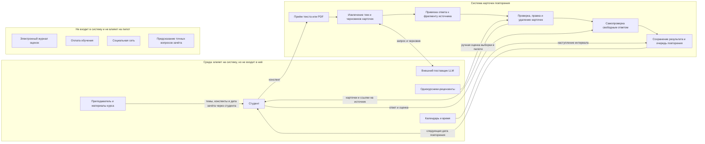

# Краткая записка о системе

**Рабочая модель для пилота:** один курс и одна группа студентов первого курса прикладной экономики. Боли и пороги пока являются гипотезами; цель пилота задана измеримо, но целевое значение ещё требует согласования с Quality & Safety.

## Цель и наблюдаемый признак

Через 14 дней после начала пилота не менее 60% всех начавших должны без конспекта воспроизвести минимум 7 из 10 заранее выбранных ключевых фактов из своего материала. Каждый факт оценивается по заранее зафиксированной рубрике: смысл сохранён — 1, иначе — 0; пропуск контрольной проверки считается недостижением. Проверяем по закрытой контрольной работе и журналу участников. Это целевой порог, а не уже полученный результат.

## Граница системы

## Стороны и несовпадающие цели

| Сторона | Своя цель | Где расходится с другими |
| --- | --- | --- |
| Студент | Быстрее подготовиться и вспомнить главное; сохранить приватность конспекта | Хочет короткий набор и быстрый ответ, тогда как преподавателю важно покрытие курса, а команде нужны данные для проверки качества |
| Преподаватель / курс | Сохранить точность и соответствие материалам курса, не подменять обучение угадыванием зачёта | Полное покрытие курса может дать больше карточек, чем студент готов повторять |
| Команда продукта и качества | Проверить пользу, полноту карточек и удержание по метрикам | Сбор подробной телеметрии облегчает оценку, но конфликтует с приватностью студента |
| Поставщик модели | Получать запросы в рамках своего API и условий обработки данных | Команде нужны ограничение стоимости и контроль над тем, как обрабатываются конспекты |
| Однокурсник-рецензент | Быстро и понятно оценить карточки | Команде нужны подробные независимые оценки, но большая разметка увеличивает нагрузку рецензента |

## Спорные элементы границы

- **Преподаватель:** внешняя среда, не пользователь MVP. Он задаёт содержание курса и контекст зачёта, но система не получает от него данные напрямую.
- **Поставщик модели:** внешняя зависимость; система отправляет ему запрос на генерацию, но выбор модели и её внутреннее устройство не входят в продуктовую границу.
- **Однокурсники-рецензенты:** участники ручной проверки пилотной выборки, а не часть обычного сценария студента.
- **Хранение конспектов и ответов:** обработка и прогресс относятся к системе, но срок хранения и доступ команды пока не согласованы. До решения хранить минимум данных и не использовать личные сведения.
- **Электронный журнал, платежи и предсказание вопросов зачёта:** сознательно вне границы и без интеграций в первом пилоте.

## Наблюдения из похода в систему

**Статус: не закрыто.** В репозитории нет полевых заметок, а реальные действия студентов нельзя вывести из описания продукта. Не выдавать гипотезы из PRD за наблюдения. Для каждого из трёх эпизодов зафиксировать:

| Эпизод | Что записать |
| --- | --- |
| 1 | Дата и место/система; задача человека; наблюдаемое действие или точная цитата; чем это удивило |
| 2 | Дата и место/система; задача человека; наблюдаемое действие или точная цитата; чем это удивило |
| 3 | Дата и место/система; задача человека; наблюдаемое действие или точная цитата; чем это удивило |

Нужны три реальных эпизода из наблюдения или согласованного walkthrough с указанием источника. После получения заметок их можно обезличить и заменить эту форму фактами.