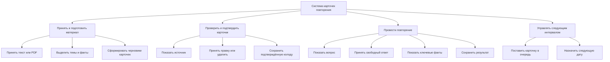
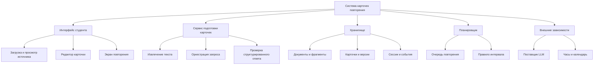

# Две декомпозиции системы

Одна и та же система разложена по двум разным основаниям. Это не два конкурирующих варианта архитектуры: первое дерево показывает **что система делает**, второе — **из каких частей она состоит**.

## 1. Функциональная декомпозиция: действия

Это дерево отвечает на вопрос: **какие преобразования проходят материал и ответ студента?** Оно показывает последовательность и точки контроля, но не показывает, где физически хранятся данные, какой внешний сервис вызывает модель и какие роли владеют компонентами.

## 2. Составная декомпозиция: части системы

Это дерево отвечает на вопрос: **какие внутренние части и зависимости нужно согласовать?** Оно показывает ответственность, данные и точки интеграции, но не показывает порядок действий пользователя и не гарантирует, что части вместе дают проживаемый сценарий.

## Что видно в одном дереве и теряется в другом

| Основание | Что хорошо видно | Что не видно без второго дерева |
| --- | --- | --- |
| Функции | Поток от загрузки до повторения, точки подтверждения и измеримый результат сценария | Компонент-владелец, хранилище, внешняя LLM и границы интеграций |
| Состав | Интерфейс, сервис, хранилище, планировщик и зависимости; места для контрактов | Порядок шагов студента, альтернативы и момент, когда карточка становится активной |

Следствие для проектирования: use cases выводятся из функционального дерева, а C4, API и схема данных — из составного. Нельзя заменить одно дерево другим: сценарий может быть функционально полным, но не иметь владельца данных; состав может быть полным, но не описывать путь студента.